<!--
theme: default
lang: en
size: 4:3
math: mathjax
paginate: true
title: Moment-based PPT criteria for random bipartite states
description: Kieran McShane, joint work with Cécilia Lancien. Journées Informatique Quantique, Toulouse, 25 November 2026.
author: Kieran McShane
style: |
  /* Scale: the beamer page is 160 x 120 mm; 960 px = 160 mm, so 1 pt = 2.117 px. */
  @font-face { font-family: "CMU Sans Serif Web"; src: url("./fonts/cmu-sans-regular.woff2") format("woff2"); font-weight: 400; font-style: normal; }
  @font-face { font-family: "CMU Sans Serif Web"; src: url("./fonts/cmu-sans-bold.woff2") format("woff2"); font-weight: 700; font-style: normal; }
  @font-face { font-family: "CMU Sans Serif Web"; src: url("./fonts/cmu-sans-oblique.woff2") format("woff2"); font-weight: 400; font-style: italic; }
  @font-face { font-family: "CMU Sans Serif Web"; src: url("./fonts/cmu-sans-bold-oblique.woff2") format("woff2"); font-weight: 700; font-style: italic; }
  section {
    background: #fff;
    color: #1c2f3a;
    font-family: "CMU Sans Serif Web", "CMU Sans Serif", "Latin Modern Sans", sans-serif;
    font-size: 25.4px;
    line-height: 1.21;
    padding: 0 48px 70px 48px;
    display: flex; flex-direction: column; justify-content: flex-start;
    letter-spacing: -0.012em;
  }
  /* Frame title at a fixed position, then the body centred in the remaining space (beamer [c]). */
  h2 {
    flex: none; color: #1c2f3a; font-weight: 700; font-size: 43.4px; line-height: 1.12;
    margin: 0 0 20px 0; padding: 47px 0 6px 0; border-bottom: 1px solid #9dc1c4; white-space: nowrap; letter-spacing: 0;
  }
  section > h2 + * { margin-top: auto !important; }
  section > :nth-last-child(1 of :not(footer, header, style, script)) { margin-bottom: auto !important; }
  section > h2:nth-last-child(1 of :not(footer, header, style, script)) { margin-bottom: 6px !important; }
  section > * { flex: none; }
  h1 { color: #1c2f3a; font-weight: 700; }
  strong, b { font-weight: 700; }
  em { font-style: italic; }
  a { color: inherit; text-decoration: none; border: none; }
  img { display: block; margin: 0 auto; background: transparent; }
  p { margin: 0; }
  ul { margin: 0; padding-left: 1.1em; }
  li { margin: 0.2em 0; }
  mjx-container[display="true"] { margin: 0.95em 0 !important; }
  mjx-container { color: inherit; font-size: 89%; }
  mjx-container[jax="SVG"] path[data-c], mjx-container[jax="SVG"] use[data-c] { stroke-width: 0 !important; }
  .cit, .cit a { color: #4a5b64; font-size: 21.2px; font-weight: 400; }
  .mute { color: #4a5b64; }
  .teal { color: #166b72; }
  .small { font-size: 23.2px; }
  .foot { font-size: 21.2px; }
  .tiny { font-size: 16.9px; }
  .center { text-align: center; }
  .sub { font-weight: 700; color: #166b72; margin: 0 0 6px 0; }
  .sub p { margin: 0; }
  .aside { color: #4a5b64; font-size: 23.2px; }
  .display { text-align: center; font-size: 36.6px; margin: 12px 0 18px 0; }
  .display mjx-container[display="true"] { margin: 0 !important; font-size: 94%; }
  .gap1 { height: 6px; } .gap2 { height: 12px; } .gap3 { height: 18px; } .gap4 { height: 24px; } .gap5 { height: 30px; }
  .cols { display: grid; gap: 0 4%; align-items: center; }
  .cols.top { align-items: start; }
  .cols > div > :first-child { margin-top: 0; }
  .stack { display: grid; } .stack > * { grid-area: 1 / 1; }
  /* booktabs */
  table { margin: 0 auto; border-collapse: collapse; font-size: inherit; line-height: 1.21; }
  table th, table td { border: none !important; padding: 0 12.7px; background: transparent !important; font-weight: 400; text-align: left; }
  table th:first-child, table td:first-child { padding-left: 0; }
  table th:last-child, table td:last-child { padding-right: 0; }
  table thead th { border-top: 1.8px solid #1c2f3a !important; border-bottom: 1px solid #1c2f3a !important; padding-top: 3px; padding-bottom: 2px; }
  table tbody tr:last-child td { border-bottom: 1.8px solid #1c2f3a !important; padding-bottom: 4px; }
  table tbody tr:first-child td { padding-top: 3px; }
  table tr { background: transparent !important; border: none !important; }
  .refs { font-size: 17.15px; line-height: 1.16; letter-spacing: 0.012em; word-spacing: 0; display: grid; grid-template-columns: 1fr 1fr; gap: 0 2%; }
  .refs p { margin: 0 0 7px 0; display: grid; grid-template-columns: 78px 1fr; }
  .refs b, .refs b a { color: #166b72; font-weight: 700; letter-spacing: 0; }
  footer { left: 48px; right: auto; bottom: 15px; font-size: 16.9px; line-height: 1; color: #4a5b64; letter-spacing: 0.03em; }
  section::after { right: 48px; bottom: 15px; font-size: 16.9px; line-height: 1; padding: 0; color: #4a5b64; }
  section.title, section.divider { justify-content: center; padding-top: 0; padding-bottom: 44px; }
  section.title > :nth-child(n of :not(footer)), section.divider > :nth-child(n of :not(footer)) { margin-top: 0 !important; margin-bottom: 0 !important; }
  section.title h1 { letter-spacing: 0; font-size: 59.3px; line-height: 67.7px; margin: 0; padding: 0; border: none; }
  section.divider { justify-content: center; }
  section.divider { align-items: center; }
  section.divider h1 { font-size: 59.3px; text-align: center; }
  section.divider h1::after { content: ""; display: block; width: 64px; height: 3px; margin: 16px auto 0; background: var(--teal, #166b72); }
  section .keep { white-space: nowrap; }
  section.dense { font-size: 23.2px; }
  .pno { position: absolute; right: 48px; bottom: 15px; font-size: 16.9px; line-height: 1; color: #4a5b64; letter-spacing: 0; }
  section.dense .sub { margin-top: 0; }
  .refs > div > p:last-child { margin-bottom: 0; }
  .purity table td:first-child, .purity table th:first-child { padding-right: 76px; }
  .purity table { margin: 0; }
  .purity table td { padding-top: 1px; padding-bottom: 3px; }
  .thresholds table { line-height: 1.3; margin: 0; }
  .thresholds table td, .thresholds table th { padding-top: 5px !important; padding-bottom: 5px !important; }
  .thresholds table thead th { padding-top: 6px !important; padding-bottom: 6px !important; }
  .thresholds table tbody tr:first-child td { padding-top: 9px !important; }
  .thresholds table tbody tr:last-child td { padding-bottom: 7px !important; }
  /* Slide 3: the two formulas with swapped indices, and the arcs drawn under them */
  .swaps { display: flex; justify-content: center; align-items: flex-start; column-gap: 44px; margin: 10px 0 24px 0; font-size: 28px; color: #1c2f3a; }
  .swap { position: relative; }
  .swap > p { line-height: 0; }
  .swap mjx-container, .swap mjx-container > svg { display: block; }
  .swap > svg.arcs { position: absolute; left: 0; top: 0; width: 100%; height: 100%; overflow: visible; }
-->

<!-- _class: title -->
<!-- _paginate: false -->

Journées Informatique QuantiqueToulouse, 25 November 2026

# Moment-based PPT criteria for random bipartite states

Kieran McShane

Joint work with Cécilia Lancien

To appear in <em>Letters in Mathematical Physics</em> (arXiv:2607.11369)

Institut Fourier, Université Grenoble Alpes & CNRS

---

<!-- footer: Entanglement -->

## Separable and entangled states

A state $\rho$ of two systems is **separable** if it is a mixture of product states:

$$\rho=\sum_i t_i\,\sigma_i\otimes\tau_i,\qquad t_i\ge0,\quad \sum_i t_i=1.$$

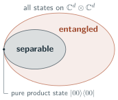

The factors $\sigma_i,\tau_i\succeq0$ are states on $\mathbb{C}^d$.

If no such decomposition exists, $\rho$ is **entangled**.

Deciding separability is NP-hard. Entanglement tests give necessary conditions for separability. [[Gurvits 2003](https://doi.org/10.1145/780542.780545)]

---

## The PPT test

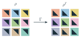

The partial transpose $\Gamma=\mathrm{id}\otimes\mathsf{T}$ transposes each block in place. With $\rho_{ij,kl}=\langle ij\rvert\rho\lvert kl\rangle$, $\Gamma$ swaps two indices and realignment swaps another pair:

<svg class="arcs" viewBox="0 -844 7460 1138" preserveAspectRatio="none" aria-hidden="true"><path d="M6116 609C6116 957 7256 957 7256 609" fill="none" stroke="#4a5b64" stroke-width="68" stroke-linecap="round"/><g fill="#4a5b64"><path d="M6116 398L5992 661L6240 661Z"/><path d="M7256 398L7132 661L7380 661Z"/></g></svg>

$(\rho^\Gamma)_{i\,\textcolor{#166b72}{j},\,k\,\textcolor{#ae4d2c}{l}}=\rho_{i\,\textcolor{#ae4d2c}{l},\,k\,\textcolor{#166b72}{j}}$

<svg class="arcs" viewBox="0 -846 7555 1140" preserveAspectRatio="none" aria-hidden="true"><path d="M6299 609C6299 957 6974 957 6974 609" fill="none" stroke="#4a5b64" stroke-width="68" stroke-linecap="round"/><g fill="#4a5b64"><path d="M6299 398L6175 661L6423 661Z"/><path d="M6974 398L6850 661L7098 661Z"/></g></svg>

$(\rho^R)_{i\,\textcolor{#166b72}{j},\,\textcolor{#ae4d2c}{k}\,l}=\rho_{i\,\textcolor{#ae4d2c}{k},\,\textcolor{#166b72}{j}\,l}$

Realignment test: $\lVert\rho^R\rVert_1\le1$ for separable $\rho$.

Every separable state has a **positive partial transpose** (PPT):

$$\rho^\Gamma=\Big(\sum_i t_i\,\sigma_i\otimes\tau_i\Big)^\Gamma=\sum_i t_i\,\sigma_i\otimes\tau_i^{\mathsf{T}}\succeq0,\qquad \tau_i^{\mathsf{T}}\succeq0.$$

A negative eigenvalue of $\rho^\Gamma$ certifies entanglement. For $d\ge3$, some entangled states are PPT and pass the test.

[[Peres 1996](https://doi.org/10.1103/PhysRevLett.77.1413); [Horodecki et al. 1996](https://doi.org/10.1016/S0375-9601(96)00706-2)]

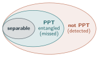

---

<!-- footer: Moment tests -->

## From the spectrum to a few moments

From tomography to eigenvalues

Reconstruct $\rho$, then diagonalize $\rho^\Gamma$. Are any of its $D=d^2$ eigenvalues $\mu_i$ negative?

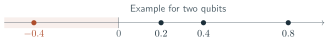

From measurements to moments

Estimate the first few moments without full tomography. [[Elben et al. 2020](https://doi.org/10.1103/PhysRevLett.125.200501)]

$$p_k=\operatorname{Tr}\big[(\rho^\Gamma)^k\big]=\sum_{i=1}^D\mu_i^k.$$

With only a few moments, can we still detect a negative eigenvalue?

---

## The first test: three moments

Since $p_1=\operatorname{Tr}\rho=1$ and $p_2=\operatorname{Tr}(\rho^2)$, the first moment test takes a simple form:

$$\rho^\Gamma\succeq0\ \Longrightarrow\ \begin{pmatrix}p_1&p_2\\p_2&p_3\end{pmatrix}\succeq0\ \Longleftrightarrow\ p_3\ge p_2^2.$$

$p_3<p_2^2$

The state is entangled.

$p_3\ge p_2^2$

The test gives no conclusion about separability.

The $p_3$-PPT test [[Elben et al. 2020](https://doi.org/10.1103/PhysRevLett.125.200501)].

---

## More moments: a hierarchy of tests

Five moments

Check whether the next shifted Hankel matrix is positive semidefinite:

$$B_2=\begin{pmatrix}p_1&p_2&p_3\\p_2&p_3&p_4\\p_3&p_4&p_5\end{pmatrix}\succeq0.$$

At level $m$

The $p_{2m+1}$-PPT test uses moments through order $2m+1$. [[Yu, Imai and Gühne 2021](https://doi.org/10.1103/PhysRevLett.127.060504)]

$$B_m=\big(p_{i+j+1}\big)_{0\le i,j\le m}\succeq0.$$

Each lower-level matrix is a principal submatrix of the next one:

$$\textsf{PPT}\ \Longrightarrow\ \cdots\ \Longrightarrow\ p_7\textsf{-PPT}\ \Longrightarrow\ p_5\textsf{-PPT}\ \Longrightarrow\ p_3\textsf{-PPT}.$$

---

## The hierarchy

Each contour encloses the states that pass the corresponding test.

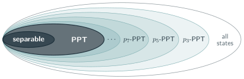

Higher levels can only shrink the set of passing states. Outside the $p_{2m+1}$-PPT contour, $2m+1$ moments certify entanglement.

**Level $m=d^2-1$ is exact: a state passes it if and only if it is PPT.** It uses moments up to order $2d^2-1$, and some non-PPT states still pass level $d^2-2$.

---

<!-- footer: Random states -->

## A benchmark: random induced states

Draw $\lvert\psi\rangle$ uniformly from the unit sphere of $A\otimes B\otimes E$ and trace out $E$:

$$\rho_s=\operatorname{Tr}_E(\lvert\psi\rangle\langle\psi\rvert),\quad \dim A=\dim B=d,\quad\dim E=s.$$

$s=1$

$\rho_s$ is a uniformly random pure state.

$s<d^2$

$\rho_s$ has rank at most $s$.

$s=d^2$

$\rho_s$ is uniform on all states (Hilbert-Schmidt measure).

$s\to\infty$ at fixed $d$

$\rho_s\to I/d^2$ in probability, the maximally mixed state.

Let $K$ contain a neighbourhood of $I/d^2$, for example the states that pass a test.

**How large must $s$ be for $\rho_s$ to lie in $K$ with high probability?**

Random induced states [[Życzkowski and Sommers 2001](https://doi.org/10.1088/0305-4470/34/35/335)].

---

## The three-moment threshold

A state is counted as detected when $p_3<p_2^2$.

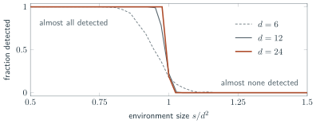

The observed transition is near $s=d^2$, the uniform (Hilbert-Schmidt) level, and sharpens as $d$ grows.

What changes if we use five or seven moments?

---

## Five and seven moments

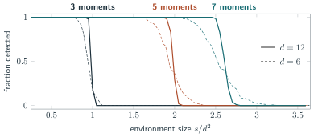

The three drops occur near $s/d^2=1$, $2$ and $2.6$, respectively. In these simulations, more moments extend the detection range.

---

<!-- footer: Results -->

## Main result: a threshold at each level

Theorem [<a href="https://arxiv.org/abs/2607.11369">Lancien and McShane 2026</a>]

Fix $m\ge1$ and $\lambda>0$. Draw an induced state on $\mathbb{C}^d\otimes\mathbb{C}^d$ with environment dimension $s\sim\lambda d^2$. Set

$$\lambda_m=4\cos^2\!\left(\frac{\pi}{m+2}\right).$$

As $d\to\infty$, the following holds with probability tending to one:

$\lambda<\lambda_m$

the $2m+1$ moment test detects entanglement,

$\lambda>\lambda_m$

the state passes the $2m+1$ moment test.

| Moments | 3 | 5 | 7 | 9 | 11 | $\cdots$ | all (PPT) |
|:--|--:|--:|--:|--:|--:|:-:|:-:|
| Threshold | 1 | 2 | $\approx2.62$ | 3 | $\approx3.25$ | $\cdots$ | 4 |

**Three moments switch exactly at $\lambda_1=1$, the Hilbert-Schmidt level $s=d^2$.** Typically, more mixed states pass and less mixed ones are detected.

---

## Detection range of each test

Each bar shows where a test typically detects entanglement in this model.

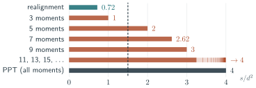

Separability threshold: $s/d^2$ of order $d$, far beyond this axis $\longrightarrow$

Dashed line: at $s/d^2=1.5$, three moments miss, five moments detect.

- **Typical behaviour in this model:** not a ranking of the tests on every state.
- Beyond $4d^2$ no test here typically detects entanglement, yet states stay entangled up to **$s$ of order $d^3$** (up to log factors).

Realignment: [Aubrun and Nechita (2012)](https://doi.org/10.1063/1.4759115). PPT: [Aubrun (2012)](https://doi.org/10.1142/S2010326312500013). Separability: [Aubrun, Szarek and Ye (2014)](https://doi.org/10.1002/cpa.21460).

---

<!-- footer: Proof and conclusions -->

## Why it holds: where the cosine comes from

Average

Write $\rho=W/\operatorname{Tr}W$, where $W=GG^*$ and $G$ has i.i.d. standard complex Gaussian entries. Wick’s formula gives the limiting rescaled moments $M_k(\lambda)$.

Concentration

For each fixed $k$, Gaussian concentration gives

$$\widetilde p_k=d^{-(2k+2)}\operatorname{Tr}[(W^\Gamma)^k]\xrightarrow{\ \mathrm{prob.}\ }M_k(\lambda).$$

Positivity

Positive rescaling preserves the test. The rescaled Hankel matrix converges to $H_m(\lambda)=(M_{i+j+1}(\lambda))_{0\le i,j\le m}$. Chebyshev polynomials give its threshold for positive semidefiniteness:

$$\sqrt{\lambda_m}/2=\cos\!\left(\frac{\pi}{m+2}\right).$$

---

## Fixed order versus full PPT

For each fixed $m$, the test with $2m+1$ moments typically detects entanglement when

$$s\sim\lambda d^2,\qquad 0<\lambda<\lambda_m=4\cos^2\!\left(\frac{\pi}{m+2}\right).$$

Three moments already reach the $d^2$ scale. Their threshold is $s\sim d^2$, compared with $s\sim4d^2$ for the full PPT test.

As $m\to\infty$, the fixed-level thresholds $\lambda_m$ increase to $4$.

Open question

What happens near $\lambda=4$ when $m$ grows with $d$?

C. Lancien and K. McShane, <a href="https://arxiv.org/abs/2607.11369">arXiv:2607.11369</a>
<strong>Thank you.</strong>

---

<!-- footer: Appendix -->
<!-- _class: divider -->
<!-- _paginate: false -->

# Backup

---

<!-- _class: dense b1 -->
<!-- _paginate: false -->

B1

## Recovering PPT from moments

For Hermitian $M\in\mathbb{C}^{D\times D}$, write $p_j(M)=\operatorname{Tr}(M^j)$, $p_0(M)=D$, and $B_m(M)=(p_{i+j+1}(M))_{i,j=0}^m$. For $q(x)=\sum_{i=0}^m a_i x^i$ with real coefficients,

$$a^{\mathsf{T}}B_m(M)a=\sum_{i,j=0}^m a_i a_j\operatorname{Tr}(M^{i+j+1})=\operatorname{Tr}\!\big(Mq(M)^2\big).$$

If $M\succeq0$, this is nonnegative for all $m$. The unshifted matrix $(p_{i+j}(M))$ gives $\operatorname{Tr}(q(M)^2)\geq0$ for every Hermitian $M$.

A polynomial that isolates a negative eigenvalue

At a negative eigenvalue $\mu$, set $q(\mu)=1$ and $q=0$ at the other distinct eigenvalues. Interpolation gives $\deg q\leq D-1$ in dimension $D$. Then $\operatorname{Tr}(Mq(M)^2)<0$, so level $D-1$ suffices.

For $\alpha>0$, $B_m(\alpha M)=\Delta_\alpha B_m(M)\Delta_\alpha$, where $\Delta_\alpha=\operatorname{diag}(\alpha^{1/2},\ldots,\alpha^{m+1/2})$. Thus for $W=GG^*$, $W^\Gamma$ and $\rho^\Gamma=W^\Gamma/\operatorname{Tr}W$ give the same test outcome.

---

<!-- _class: dense b2 -->
<!-- _paginate: false -->

B2

## Rank and purity of an induced state

With $D=d^2$, draw $G\in\mathbb{C}^{D\times s}$ with i.i.d. standard complex Gaussian entries. Set $W=GG^*$ and $\rho=W/\operatorname{Tr}W$. [[Życzkowski and Sommers 2001](https://doi.org/10.1088/0305-4470/34/35/335)]

$$\operatorname{rank}\rho=\min(D,s)\quad\text{a.s.},\qquad \mathbb{E}\,\operatorname{Tr}\rho^2=\frac{D+s}{Ds+1}.$$

Three environment sizes

| Environment | Mean purity |
|:--|:--|
| $s=1$ | $1$ (a pure state) |
| $s$ fixed, $D\to\infty$ | $\longrightarrow 1/s$ |
| $s\sim\lambda D$, $\lambda>0$ fixed | $\sim (1+1/\lambda)/D\longrightarrow0$ |

For comparison, the maximally mixed state $I_D/D$ has purity $1/D$.

---

<!-- _class: dense b3 -->
<!-- _paginate: false -->

B3

## Average moments from Wick calculus

Let $W=GG^*$, with $G$ a $d^2\times s$ standard complex Gaussian matrix. Write $\gamma=(1\,2\cdots k)$ and $\#(\pi)$ for the number of cycles of $\pi$. Then

$$\mathbb{E}\,\operatorname{Tr}[(W^\Gamma)^k]=\sum_{\pi\in S_k}d^{\#(\gamma^{-1}\pi)+\#(\pi\gamma)}s^{\#(\pi)}.$$

The partial transpose replaces one of the two copies of $\gamma^{-1}$ by $\gamma$.

Leading terms when $s/d^2\to\lambda>0$

The noncrossing permutations with cycles of length at most two contribute $M_k(\lambda)d^{2k+2}$ to leading order, where

$$M_k(\lambda)=\sum_{j=0}^{\lfloor k/2\rfloor}\binom{k}{2j}\mathrm{Cat}(j)\lambda^{k-j},\qquad \mathrm{Cat}(j)=\frac{1}{j+1}\binom{2j}{j}.$$

Thus $M_1=\lambda$, $M_2=\lambda^2+\lambda$ and $M_3=\lambda^3+3\lambda^2$.

These are the moments of the limiting spectral law of $W^\Gamma/d^2$, a semicircle with mean $\lambda$ and variance $\lambda$. [[Aubrun 2012](https://doi.org/10.1142/S2010326312500013)]

---

<!-- _class: dense b4 -->
<!-- _paginate: false -->

B4

## Concentration of the rescaled moments

Fix $k\geq1$ and $\lambda>0$, with $s=\lfloor\lambda d^2\rfloor$. The polynomial $\widetilde p_k=d^{-(2k+2)}\operatorname{Tr}[(W^\Gamma)^k]$ has degree $2k$ in the Gaussian entries. A Wick count on $S_{2k}$ gives $\operatorname{Var}(\widetilde p_k)=O_{\lambda,k}(d^{-2})$.

A tail bound for one moment

By Gaussian hypercontractivity [[Aubrun and Szarek 2017](https://doi.org/10.1090/surv/223)], for large $d$ and $\varepsilon\geq C_{\lambda,k}/d$,

$$\mathbb{P}\!\left(|\widetilde p_k-M_k(\lambda)|>\varepsilon M_k(\lambda)\right)\leq \exp\!\left(-c_{\lambda,k}\,(\varepsilon d)^{1/k}\right).$$

Probability of the predicted test outcome

For fixed $m$ and $\lambda\ne\lambda_m$, concentration of the Hankel determinants gives probability at least $1-(m+1)^2\exp(-c_{\lambda,m}d^\kappa)$, with $\kappa=1/(2m+1)$.

For the normalized state, Lévy’s lemma on the sphere with local Lipschitz constants gives sub-Gaussian bounds and the stronger exponent $\kappa=2+2/(2m+1)$. [[Lancien and McShane 2026](https://arxiv.org/abs/2607.11369)]

---

<!-- _class: dense b5 -->
<!-- _paginate: false -->

B5

## Spectral edge and quadrature nodes

For $\lambda>0$, the semicircle law $\mu_\lambda$ has moments $M_k(\lambda)$ and support $[\lambda-2\sqrt\lambda,\,\lambda+2\sqrt\lambda]$.

Full PPT test

The smallest eigenvalue of $W^\Gamma/d^2$ converges to the left edge. [[Aubrun 2012](https://doi.org/10.1142/S2010326312500013)]

$$\lambda-2\sqrt\lambda\geq0\iff\lambda\geq4.$$

Level $m$

Level $m$ requires $\int xq(x)^2\,d\mu_\lambda\geq0$ for all real $q$ of degree at most $m$. Gauss quadrature is exact here. Its $m+1$ weights are positive. Interpolating $q$ at the nodes isolates each one, so the smallest node determines the sign test.

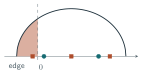

$\bullet$ $m=1$ &emsp;&emsp; $\blacksquare$ $m=2$

At $\lambda=1.5$, both level-1 nodes are positive. One level-2 node and the edge are negative.

The smallest node is nonnegative precisely when $\lambda-2\sqrt\lambda\cos\!\big(\frac{\pi}{m+2}\big)\geq0$, or $\lambda\geq\lambda_m$.

---

<!-- _class: dense b6 -->
<!-- _paginate: false -->

B6

## Signs of the leading Hankel minors

For $\lambda>0$, let $H_\ell=(M_{i+j+1}(\lambda))_{i,j=0}^{\ell}$. The Chebyshev polynomials $U_n$ of the second kind give

$$\det H_\ell=\lambda^{(\ell+1)^2/2}U_{\ell+1}\!\left(\frac{\sqrt\lambda}{2}\right).$$

Above $\lambda_m$

For every $0\leq\ell\leq m$, $\det H_\ell>0$. Sylvester’s criterion gives $H_m\succ0$.

Below $\lambda_m$

Take the first $\ell\leq m$ with $\lambda<\lambda_\ell$. Interlacing of consecutive Chebyshev zeros gives $\det H_\ell<0$. This principal submatrix rules out $H_m\succeq0$.

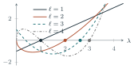

Dots mark the largest zeros $\lambda_\ell$ of $U_{\ell+1}(\sqrt\lambda/2)$.

One nonnegative determinant alone cannot certify positive semidefiniteness. At $\lambda=\lambda_m$, $H_m$ is singular and the limit does not decide the random test.

---

<!-- _class: dense b7 -->
<!-- _paginate: false -->

B7

## Detection rates for all five tests

Solid curves show $d=12$ with 200 states per point. Dashed curves show $d=6$ with 400 states per point. The upper labels give the number of moments, or PPT.

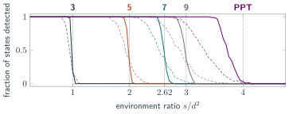

At these finite sizes, the PPT transition lies to the left of its limiting value $4$.

---

<!-- _class: dense b8 -->
<!-- _paginate: false -->

B8

## Thresholds in the balanced model

Consider induced states on $\mathbb{C}^d\otimes\mathbb{C}^d$ as $d\to\infty$, away from the critical ratios.

| Criterion | Environment at the threshold | Source |
|:--|:--|:--|
| Realignment | $s=(8/(3\pi))^2d^2\approx0.72\,d^2$ | [[Aubrun and Nechita 2012](https://doi.org/10.1063/1.4759115)] |
| $2m+1$ moments | $s=4\cos^2\!\big(\frac{\pi}{m+2}\big)d^2$ | [[Lancien and McShane 2026](https://arxiv.org/abs/2607.11369)] |
| PPT | $s=4d^2$ | [[Aubrun 2012](https://doi.org/10.1142/S2010326312500013)] |
| Separability | between $c\,d^3$ and $C\,d^3\log^2 d$ | [[Aubrun, Szarek and Ye 2014](https://doi.org/10.1002/cpa.21460)] |

Typical PPT entangled states

Above the PPT threshold and below the separability threshold, a typical state is PPT and entangled. For example, this holds when $s/d^2\to\lambda$ for a fixed $\lambda>4$. It then passes every test in the moment hierarchy.

---

<!-- _class: dense b9 -->
<!-- _paginate: false -->

B9

## Unequal local dimensions

On $\mathbb{C}^{d_1}\otimes\mathbb{C}^{d_2}$, fix $d_1\geq2$ and let $d_2\to\infty$ with $s/(d_1d_2)\to\lambda>0$. At fixed level $m$, the state violates the criterion with probability tending to one if $\lambda<\lambda_m(d_1)$ and satisfies it with probability tending to one if $\lambda>\lambda_m(d_1)$.

Expansion as $d_1\to\infty$

$$\lambda_m(d_1)=4\cos^2\!\left(\frac{\pi}{m+2}\right)-\frac{1}{d_1^2}+O_m(d_1^{-4}).$$

The paper sketches the threshold argument and states this probability limit without an explicit tail bound in $d_2$. [[Lancien and McShane 2026, Sec. 7](https://arxiv.org/abs/2607.11369)]

The positivity threshold for the limiting spectrum, $2(1+\sqrt{1-d_1^{-2}})$, has the same first correction $-1/d_1^2$. This correction is independent of $m$. [[Banica and Nechita 2013](https://doi.org/10.1007/s10959-012-0409-4)]

---

<!-- _class: b10 -->
<!-- _paginate: false -->

B10

## References

<b><a href="https://arxiv.org/abs/2607.11369">LM26</a></b>C. Lancien, K. McShane. Moment-based PPT criteria for random bipartite states. <em>Lett. Math. Phys.</em>, to appear. arXiv:2607.11369, 2026.

<b><a href="https://doi.org/10.1063/1.4759115">AN12</a></b>G. Aubrun, I. Nechita. Realigning random states. <em>J. Math. Phys.</em> 53:102210, 2012.

<b><a href="https://doi.org/10.1090/surv/223">AS17</a></b>G. Aubrun, S. J. Szarek. <em>Alice and Bob Meet Banach</em>. AMS, 2017.

<b><a href="https://doi.org/10.1002/cpa.21460">ASY14</a></b>G. Aubrun, S. J. Szarek, D. Ye. Entanglement thresholds for random induced states. <em>Comm. Pure Appl. Math.</em> 67:129–171, 2014.

<b><a href="https://doi.org/10.1142/S2010326312500013">Aub12</a></b>G. Aubrun. Partial transposition of random states and non-centered semicircular distributions. <em>Random Matrices Theory Appl.</em> 1:1250001, 2012.

<b><a href="https://doi.org/10.1007/s10959-012-0409-4">BN13</a></b>T. Banica, I. Nechita. Asymptotic eigenvalue distributions of block-transposed Wishart matrices. <em>J. Theoret. Probab.</em> 26:855–869, 2013.

<b><a href="https://doi.org/10.1103/PhysRevA.109.012422">CVV+24</a></b>J. Carrasco, M. Votto, V. Vitale et al. Entanglement phase diagrams from partial transpose moments. <em>Phys. Rev. A</em> 109:012422, 2024.

<b><a href="https://doi.org/10.1145/780542.780545">Gur03</a></b>L. Gurvits. Classical deterministic complexity of Edmonds’ problem and quantum entanglement. <em>STOC</em>, 10–19, 2003.

<b><a href="https://doi.org/10.1103/PhysRevLett.125.200501">EKH+20</a></b>A. Elben, R. Kueng, H.-Y. Huang et al. Mixed-state entanglement from local randomized measurements. <em>Phys. Rev. Lett.</em> 125:200501, 2020.

<b><a href="https://doi.org/10.1016/S0375-9601(96)00706-2">HHH96</a></b>M. Horodecki, P. Horodecki, R. Horodecki. Separability of mixed states: necessary and sufficient conditions. <em>Phys. Lett. A</em> 223:1–8, 1996.

<b><a href="https://doi.org/10.1103/PhysRevLett.77.1413">Per96</a></b>A. Peres. Separability criterion for density matrices. <em>Phys. Rev. Lett.</em> 77:1413–1415, 1996.

<b><a href="https://doi.org/10.1103/PhysRevLett.127.060504">YIG21</a></b>X.-D. Yu, S. Imai, O. Gühne. Optimal entanglement certification from moments of the partial transpose. <em>Phys. Rev. Lett.</em> 127:060504, 2021.

<b><a href="https://doi.org/10.1088/0305-4470/34/35/335">ZS01</a></b>K. Życzkowski, H.-J. Sommers. Induced measures in the space of mixed quantum states. <em>J. Phys. A</em> 34:7111–7125, 2001.

